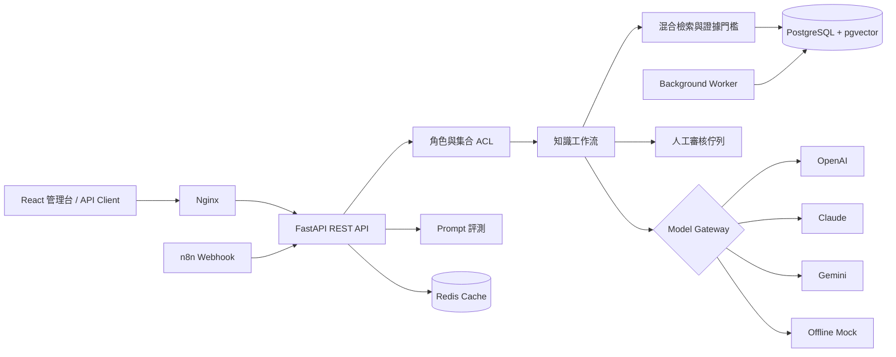

# KnowledgeOps Studio

一個可離線展示、也能接上真實模型的企業知識工作流平台。它把多模型 Gateway、
Prompt 版本、RAG、文件治理、權限、人工審核與品質評測整合成一個可追溯的產品，
重點不是「產生一段文字」，而是穩定交付有來源、有品質門檻、可追責的業務結果。

> 專案狀態：公司實務版 v1.0.1。預設完全離線、零 API 費用；所有範例文件與評測題均為
> 本專案原創合成資料，不含私人資料、客戶資料或未授權素材。

## 為什麼做這個專案

企業導入生成式 AI 時，真正困難的通常不是呼叫一次 API，而是下面這條完整責任鏈：

- 使用者只能查到被授權的文件。
- 模型回答必須附上可驗證的來源，而不是憑空補完。
- 證據不足或結構不合法時要自動轉人工，不讓錯誤直接流向客戶。
- Prompt、模型、文件與審核操作都要能回溯版本。
- 模型切換前必須用固定案例比較品質、拒答、延遲與成本。

KnowledgeOps Studio 將這些問題做成可執行的通用產品，而不是只放一份 Notebook。

## 使用情境、輸入與輸出

| 項目 | 定義 |
|---|---|
| 使用情境 | 內部制度查詢、客服支援、營運 SOP、文件型決策輔助 |
| 輸入 | 問題、授權知識集合、Prompt 版本、模型供應商；或 UTF-8/PDF 文件 |
| 核心處理 | ACL → 解析/切塊 → 混合檢索 → 證據門檻 → 結構化生成 → 引用驗證 → 人工分流 → 稽核 |
| 輸出 | 回答、文件引用、證據分數、模型/Prompt 版本、token/延遲、工作流狀態與 trace |
| 失敗策略 | 無證據時拒答；無效引用、供應商錯誤或低信心時進入人工審核 |

## 完整功能

- 多模型 Gateway：OpenAI Responses API、Claude Messages API、Gemini GenerateContent，另有零成本 mock。
- PromptOps：不可變版本、SHA-256 設定雜湊、draft/released/retired 與回滾基礎。
- RAG：TXT、Markdown、CSV、JSON、PDF；SHA-256 去重、版本化、LangChain 切塊、混合檢索。
- 品質防線：相對檢索門檻、JSON Schema 輸出、引用白名單驗證、低證據人工接手。
- 文件與資料權限：集合 ACL、admin/editor/reviewer/viewer 四種角色、軟刪除。
- Workflow：同步 REST 執行或資料庫佇列背景 worker；每次狀態轉換都留事件。
- 評測：固定題集計算通過率、關鍵詞召回、引用率、拒答準確率及中位延遲。
- 管理介面：React + TypeScript 的營運總覽、知識任務、文件、Prompt、評測、稽核頁。
- 基礎設施：PostgreSQL + pgvector、Redis rate limit、Docker Compose、Alembic、Nginx、n8n 範例與 CI。

## 系統架構



細部元件責任與故障邊界見 [架構文件](docs/architecture.md)。

## 五分鐘離線 Demo

需求：Python 3.11+、Node.js 24+、pnpm。Windows PowerShell：

```powershell
python -m venv .venv
.\.venv\Scripts\Activate.ps1
python -m pip install --upgrade pip
python -m pip install -e ".[dev]"
knowledgeops doctor
knowledgeops run-demo
knowledgeops evaluate
```

另開兩個終端：

```powershell
# 終端一
.\.venv\Scripts\Activate.ps1
knowledgeops serve --host 127.0.0.1 --port 8000

# 終端二
cd frontend
pnpm install --frozen-lockfile
pnpm dev
```

開啟 `http://127.0.0.1:5173`。API 文件在 `http://127.0.0.1:8000/docs`。

預設 mock 會走完整 RAG、權限、驗證及稽核流程，但不會把任何資料傳到網路，也不會產生費用。

### Demo 身分

介面可直接切換下列合成身分；REST Client 以 `X-Demo-User` 傳入使用者名稱。

| 使用者 | 角色 | 主要權限 |
|---|---|---|
| `admin` | 管理員 | 集合授權、Prompt 發布、評測、稽核 |
| `editor` | 編輯者 | 文件與 Prompt 草稿 |
| `reviewer` | 審核者 | 讀取範圍內資料與人工核准 |
| `viewer` | 使用者 | 送出被授權集合的知識任務 |

這個 Header 只用於本機作品展示，絕不是正式驗證機制；正式環境的替換方式見
[安全文件](docs/security.md)。

## Docker 完整環境

需求：Docker Engine 與 Compose v2。

```powershell
Copy-Item .env.example .env
docker compose up --build
```

- Web：`http://localhost:8080`
- API / OpenAPI：`http://localhost:8000/docs`
- PostgreSQL：只在 Compose 內部開放，啟用 `vector` extension。
- Redis：只在 Compose 內部開放，連線失敗時程式會安全退回記憶體快取。

選配 n8n：

```powershell
docker compose --profile automation up --build
```

到 `http://localhost:5678` 匯入
[`infra/n8n/knowledge-request.workflow.json`](infra/n8n/knowledge-request.workflow.json)。工作流只呼叫本機 API，
預設未啟用、不含 Credential，也不會建立外部資源。

## 串接真實模型

先複製 `.env.example` 成 `.env`，只填需要使用的供應商 Key。`.env` 已由 Git 忽略。

```dotenv
OPENAI_API_KEY=
ANTHROPIC_API_KEY=
GEMINI_API_KEY=
```

未設定的供應商不會被呼叫；若任務指定未設定的供應商，系統會留下 fallback 事件並使用 mock。
預設送給供應商的請求禁止 OpenAI 儲存輸出，安全識別碼採不可逆雜湊，不傳使用者姓名或信箱。
模型參數與官方 API 對應見 [模型供應商指南](docs/model-providers.md)。

## 評測結果

目前原創合成題集共 6 題，包含 5 題可回答案例與 1 題範圍外拒答案例。離線 deterministic baseline：

| 指標 | v1 baseline |
|---|---:|
| 案例通過率 | 100% |
| 引用率 | 83.3% |
| 拒答準確率 | 100% |
| 外部 API 費用 | 0 |

這組數字只代表 mock + 合成題集的可重現驗收，不宣稱真實 LLM 品質。填入模型 Key 後應分別建立
provider baseline，再依資料敏感度與業務風險設定發布門檻。詳見 [評測策略](docs/evaluation.md)。

## 測試與品質檢查

```powershell
# 後端
python -m ruff check backend tests migrations
python -m mypy backend
python -m pytest --cov=knowledge_ops --cov-report=term-missing

# 前端
cd frontend
pnpm typecheck
pnpm test
pnpm build

# Alembic
alembic upgrade head
alembic check

# 已追蹤檔案隱私掃描
.\scripts\privacy-check.ps1
```

CI 在 Linux 上重跑後端、前端、Alembic 與隱私檢查。`scripts/verify.ps1` 可在本機一次執行全套驗證。

## 專案結構

```text
backend/knowledge_ops/   FastAPI、RAG、模型 Gateway、ACL、評測與 worker
frontend/                React、TypeScript、Vite 管理介面
examples/                原創合成知識文件與 JSONL 評測集
migrations/              Alembic schema migration
infra/n8n/               選配的本機 webhook 工作流
scripts/                 驗證與隱私掃描
tests/                   後端自動化測試
docs/                    架構、安全、模型與評測決策
compose.yaml             PostgreSQL、Redis、API、worker、Web、選配 n8n
```

## 限制與下一步

- Demo 身分 Header 必須換成 OIDC/OAuth2 JWT 與組織 IdP；目前不可直接作為正式登入。
- 離線 embedding 是 384 維 deterministic hashing，只用來證明流程與可重現測試，不等同語意模型。
- PostgreSQL 先用 pgvector cosine distance 篩選候選，再由應用層做 keyword rerank；SQLite Demo 則掃描小型集合。
- 背景 worker 使用資料庫 queue；高吞吐量應改成 Redis Streams、Celery 或雲端佇列並加 retry/dead-letter。
- 真實模型連線需要使用者自行提供 Key，尚未在此環境執行付費 API 測試。
- 尚未部署 AWS/GCP，也沒有建立任何外部服務；`compose.yaml` 是本機可移植基準。
- n8n 僅提供可匯入工作流，未代替核心商業邏輯，也未建立 Credential。

更完整的技術債與優先順序見 [架構決策](docs/decisions.md)。

## 授權與資料來源

本專案程式碼、範例知識文件及評測案例以 [MIT License](LICENSE) 釋出。直接相依套件與選配容器的
授權摘要見 [THIRD_PARTY_NOTICES.md](THIRD_PARTY_NOTICES.md)。大型資料集、模型權重、Key、Token、
私人檔案與執行期資料皆不納入 Git。
