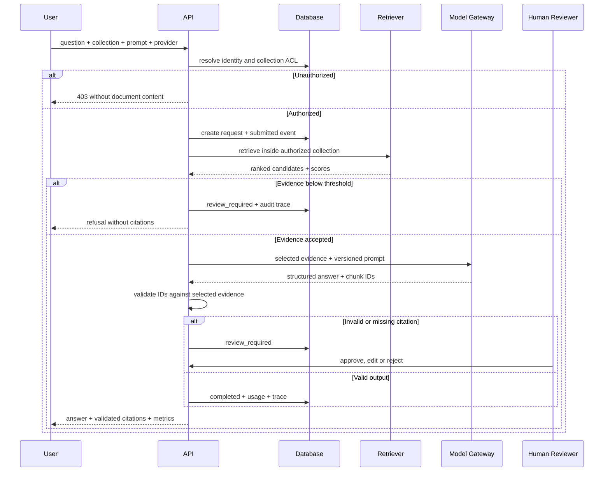

# 架構與責任邊界

## 設計目標

KnowledgeOps Studio 把「產生答案」視為工作流中的其中一步。核心設計目標是：授權先於檢索、
證據先於生成、驗證先於交付、版本與稽核貫穿整個生命週期。

## 元件責任

| 元件 | 責任 | 不負責的事項 |
|---|---|---|
| React 管理台 | 展示業務指標、文件、Prompt、評測、審核與稽核 | 不在瀏覽器保存 API Key |
| FastAPI | REST 契約、身分解析、ACL、輸入驗證與流程協調 | 不把供應商格式洩漏給前端 |
| Model Gateway | 統一請求/回應、timeout、結構化輸出與錯誤正規化 | 不決定使用者可讀哪些資料 |
| Retrieval | 集合限定、向量 + 關鍵詞排名、相對門檻 | 不跨集合搜尋 |
| Workflow | 狀態機、證據 gate、引用驗證、人工分流 | 不接受模型自報的未授權引用 |
| PostgreSQL | 主資料、版本、稽核、事件與 pgvector 儲存 | 不保存原始 API Key |
| Redis | 每使用者知識任務 rate limit 與可擴充快取 | 失效時不影響資料正確性 |
| Worker | 消化 `submitted` 任務，PostgreSQL 以 `SKIP LOCKED` claim | SQLite 模式不支援多 worker |
| n8n | 外部 webhook 與流程編排範例 | 不承載 ACL、RAG 或品質門檻核心邏輯 |

## 知識任務時序

## 資料模型

- `users`、`collections`、`collection_access`：身分與資料範圍。
- `documents`、`chunks`：SHA-256 去重、文件版本、來源標籤、內容與 embedding。
- `prompt_templates`：不可變 Prompt 設定、發布狀態與完整設定雜湊。
- `knowledge_requests`、`workflow_events`：任務結果與狀態歷程。
- `evaluation_cases`、`evaluation_runs`、`evaluation_results`：可重現品質 gate。
- `audit_logs`：高價值操作的 append-only 應用層紀錄。

## 可用性與退化策略

1. 未設定模型 Key：留下 `provider_fallback` 事件，使用離線 mock。
2. Redis 不可用：退回 process-local memory cache；主資料仍由資料庫保證。
3. 模型 timeout/錯誤：任務標記 `failed` 且 `needs_review=true`，不回傳半成品。
4. 低證據：在呼叫模型前拒答，節省成本並降低幻覺。
5. 引用不合法：即使答案看似合理也不自動完成。

## 擴充路徑

- 把 demo identity adapter 換成 OIDC middleware，不修改領域服務。
- 把 hashing embedding 換成受版控的 embedding service，保留 chunk contract。
- PostgreSQL 大型資料量改用 HNSW/IVFFlat SQL top-k，再做 keyword rerank。
- worker queue 換成 Redis Streams、SQS/Pub/Sub，維持相同任務狀態機。
- 供應商 adapter 加入 rate limit、retry with jitter、circuit breaker 與實際價格表。
